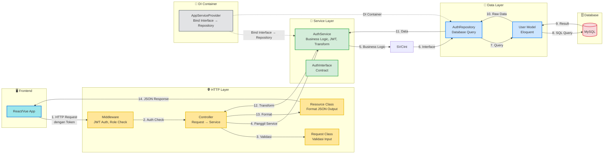

# 📋 Aturan Arsitektur Sistem Backend (Laravel Clean Architecture)

Berikut adalah gambaran arsitektur **Clean Architecture** backend Laravel yang diterapkan pada project ini. Diagram ini menunjukkan bagaimana struktur folder disusun, bagaimana arah dependensi mengalir, serta bagaimana **DI Container (Providers)** dan **Public API (`index.ts`)** menjaga pembatasan kode.

---

## 📐 1. Diagram Aliran Data & Hubungan Antar-Layer (Backend Feature)

Diagram ini menggambarkan bagaimana sebuah fitur (misal: `Auth` atau `Dashboard`) bekerja di dalamnya. Perhatikan bahwa **Domain Layer berada di tengah dan bersifat suci (tidak punya dependensi ke luar)**.

```mermaid
graph TD
    %% Styling
    classDef domain fill:#d4edda,stroke:#28a745,stroke-width:2px,color:#155724;
    classDef data fill:#cce5ff,stroke:#007bff,stroke-width:2px,color:#004085;
    classDef pres fill:#fff3cd,stroke:#ffc107,stroke-width:2px,color:#856404;
    classDef di fill:#e2e3e5,stroke:#6c757d,stroke-width:2px,color:#383d41;
    classDef infra fill:#f8d7da,stroke:#dc3545,stroke-width:2px,color:#721c24;

    %% Global Infrastructure Boundary
    subgraph Global_Infra [🌐 Global Infrastructure & Shared]
        apiClient[Middleware <br> JWT Auth, Role Check]:::infra
        sharedUI[Exception Handler <br> Format JSON Standard]:::infra
    end

    %% Feature Boundary
    subgraph Feature_Auth [📦 Feature: Auth]
        
        %% Public API Gate
        publicAPI[🚪 AuthController.php <br>HTTP Entry Point]:::pres

        %% Presentation Layer (HTTP)
        subgraph Presentation_Layer [🎨 Presentation Layer - HTTP]
            page[Routes <br>RouteServiceProvider]:::pres
            req[Request Classes <br>Validasi Input]:::pres
            res[Resource Classes <br>Format JSON Output]:::pres
            mid[Middleware <br>Auth & Authorization]:::pres
        end

        %% DI Layer
        subgraph DI_Layer [🔌 DI Layer - Providers]
            container[AppServiceProvider.php <br>Interface → Repository Binding]:::di
        end

        %% Domain Layer
        subgraph Domain_Layer [🧠 Domain Layer - Service]
            usecase[AuthService.php <br>Business Logic]:::domain
            repoInterface[AuthInterface.php <br>Contract]:::domain
        end

        %% Data Layer
        subgraph Data_Layer [💾 Data Layer - Repository & Model]
            repoImpl[AuthRepository.php]:::data
            entity[User.php <br>Eloquent Model]:::data
        end
    end

    %% Dependency Flow (Request → Response)
    apiClient --> page
    page --> publicAPI
    req --> publicAPI
    
    %% The Secret Bridge (DI)
    container -.->|bind}| usecase
    container -.->|bind}| repoImpl
    
    %% Inner Connections
    publicAPI --> usecase
    usecase --> repoInterface
    repoInterface --> entity
    
    repoImpl --> entity
    repoImpl --> repoInterface

    %% External Connections
    usecase --> sharedUI
    page --> sharedUI
    
    %% Public API Gate Connection
    publicAPI --> res
    
    %% Outside Consumer
    Frontend[Frontend (React/Vue)] -->|HTTP Request| apiClient

```

Gunakan kode dengan hati-hati.

---

## 🧱 2. Diagram Komunikasi Antar-Layers (Request Flow)

Diagram ini menunjukkan alur request dari frontend hingga database dan return response:



---

## 🔍 Cara Membaca Diagram:

1. **Paling Suci (Hijau/Domain):** `Service` berada di tengah tidak memiliki panah keluar menuju layer lain. Dia terisolasi sempurna dan hanya menerima perintah melalui Interface.
2. **Pabrik DI (Abu-abu):** `AppServiceProvider` adalah satu-satunya area yang boleh menyentuh Domain dan Data sekaligus untuk merakit fungsi sebelum diberikan ke Controller.
3. **Pintu Gerbang (Koordinate/Presentasi):** `Controller` yang dipanggil `AppRouter` dilarang keras mengintip repository atau model langsung. Semua akses wajib melalui Service.

---

## 📁 3. Struktur Folder yang Diiktigafikan

```
app/
├── Http/                           # Presentation Layer
│   ├── Controllers/                 # Endpoint API
│   │   ├── Auth/
│   │   │   └── AuthController.php
│   │   ├── Dashboard/
│   │   │   └── DashboardController.php
│   │   └── Master/
│   │       └── Account/
│   │           └── MasterAccountController.php
│   ├── Middleware/                  # JWT, Role Check
│   ├── Requests/                    # Request Validation
│   └── Resources/                   # JSON Response Format
│
├── Services/                       # Domain Layer (Business Logic)
│   ├── Auth/
│   │   └── AuthService.php
│   ├── Dashboard/
│   │   └── DashboardService.php
│   └── Master/
│       └── Account/
│           └── MasterAccountService.php
│
├── Repositories/                   # Data Layer
│   ├── Auth/
│   │   └── AuthRepository.php
│   ├── Dashboard/
│   │   └── DashboardRepository.php
│   └── Master/
│       └── Account/
│           └── MasterAccountRepository.php
│
├── Interfaces/                     # Contracts (Domain)
│   ├── Auth/
│   │   └── AuthInterface.php
│   └── ...
│
├── Models/                         # Entity Layer
│   ├── User.php
│   └── ...
│
├── Providers/                      # DI Layer
│   └── AppServiceProvider.php
│
├── Exceptions/                     # Error Handling
│   ├── Handler.php
│   └── ApiExceptionHandler.php
│
├── Helpers/                        # Utility Functions
│   └── QueryFilterHelper.php
│
└── Traits/
    └── ApiResponse.php              # Response Helper
```

---

## 🎯 4. Aturan Utama (Rules)

### Dependency Direction
- **Controller → Service → Interface → Repository → Model → Database**
- **Tidak boleh langsung Controller ↔ Repository** (harus lewat Service)
- **Tidak boleh langsung Repository ↔ Controller** (harus lewat Service)

### Interface Binding (DI)
```php
// app/Providers/AppServiceProvider.php
$this->app->bind(AuthInterface::class, AuthRepository::class);
```

### Request Validation
- Semua validasi diarahkan ke `Request` class, bukan langsung di Controller
- Controller hanya menggunakan `$request->validated()`

### Response Format
```json
{
    "meta": {
        "status": 200,
        "message": "Success message"
    },
    "data": {...},
    "errors": null
}
```

### Exception Handling
- Semua exception dikonversi ke format JSON standar oleh `ApiExceptionHandler`
- Error 4xx tidak di-log, 5xx harus di-log

---

## 💡 Tips untuk Frontend Developer

1. **Controller = Penghubung** - Fokus pada request/response, tidak buat logika kompleks
2. **Service = Aturan Bisnis** - Semua aturan aplikasi ada di sini (JWT, role mapping, transformasi data)
3. **Repository = Query Database** - Hanya ambil/berikan data mentah
4. **Interface = Kontrak API** - Frontend tidak perlu tahu concrete class mana yang dipakai
5. **Provider = DI Container** - Frontend tidak perlu tahu binding mana yang aktif

---

## 🔗 Navigasi Cepat ⟶
- [[services]] - Business logic layer
- [[repositories]] - Data access layer
- [[http]] - Request/response handling
- [[model]] - Eloquent entities
- [[interface]] - Contract definitions
- [[providers]] - Dependency injection container
- [[exceptions]] - Error handling
- [[helper]] - Utility functions