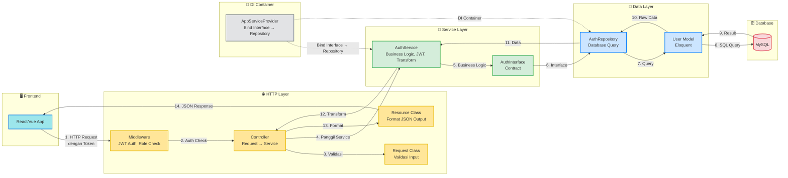

# 📋 Laravel Clean Architecture (Backend)

Berikut adalah penjelasan detail fungsi dari masing-masing folder dan file berdasarkan blueprint **Clean Architecture** yang diterapkan pada project Laravel backend ini.

Kita akan menggunakan contoh studi kasus fitur **Auth** untuk memperjelas alur data.

---

## 🧠 1. Domain Layer (`Services/`)

Layer ini adalah **otak dari bisnis Anda**. Layer ini berisi logika bisnis yang tidak tergantung pada framework atau database.

### 📁 `Services/AuthService.php`

- **Fungsi:** Berisi aturan bisnis seperti login, register, JWT generation, dan role mapping.
- **Contoh Isi:**

```php
class AuthService
{
    public function __construct(protected AuthInterface $authInterface) {}

    public function login(array $credential)
    {
        return DB::transaction(function () use ($credential) {
            $token = JWTAuth::attempt($credential);
            if (!$token) {
                throw new HttpException(401, 'Email atau password salah');
            }

            $user = JWTAuth::user();
            if (!$user->is_active) {
                JWTAuth::setToken($token)->invalidate();
                throw new HttpException(403, 'Akun tidak aktif');
            }

            [$role, $access] = $this->resolveRoleAccess($user);

            return [
                'user' => $user,
                'role' => $role,
                'access' => $access,
                'token' => $token,
                'expires_in' => JWTAuth::factory()->getTTL() * 60,
            ];
        });
    }

    protected function resolveRoleAccess($user): array
    {
        $user->load('role.roleMenus.menu');

        $role = null;
        $access = [];

        if ($user->role) {
            $role = [
                'id' => $user->role->id,
                'name' => $user->role->name,
                'slug' => $user->role->slug,
            ];

            foreach ($user->role->roleMenus as $rm) {
                $access[$rm->menu->code] = [
                    'view' => $rm->can_view,
                    'create' => $rm->can_create,
                    'update' => $rm->can_update,
                    'delete' => $rm->can_delete,
                ];
            }
        }

        return [$role, $access];
    }
}
```

---

## 💾 2. Data Layer (`Repositories/`)

Layer ini bertanggung jawab mengakses database melalui Eloquent Model dan mengembalikan data mentah.

### 📁 `Repositories/AuthRepository.php`

- **Fungsi:** Implementasi query database untuk operasi auth. Menerima perintah dari Service lewat Interface.
- **Contoh Isi:**

```php
class AuthRepository implements AuthInterface
{
    public function register(array $data)
    {
        $user = User::create([
            'name' => $data['name'],
            'email' => $data['email'],
            'password' => bcrypt($data['password']),
        ]);

        $token = JWTAuth::fromUser($user);

        return ['user' => $user, 'token' => $token];
    }

    public function findByEmail(string $email)
    {
        return User::where('email', $email)->first();
    }

    public function updatePassword(string $userId, string $password)
    {
        return User::where('id', $userId)->update(['password' => $password]);
    }
}
```

### 📁 `Models/User.php`

- **Fungsi:** Eloquent Model yang merepresentasikan tabel `users` di database.

```php
class User extends Authenticatable implements JWTSubject
{
    use HasFactory, Notifiable, HasUuids;

    protected $fillable = [
        'name', 'email', 'password', 'role_id', 'nip', 'username', 'is_active'
    ];

    protected $hidden = ['password', 'remember_token'];

    protected function casts(): array
    {
        return ['password' => 'hashed'];
    }

    public function role()
    {
        return $this->belongsTo(Role::class);
    }

    public function getJWTIdentifier() { return $this->getKey(); }
    public function getJWTCustomClaims() { return []; }
}
```

---

## 🔌 3. Dependency Injection Layer (`Providers/`)

Layer penghubung rahasia yang mengatur binding antar interface dan implementasi.

### 📁 `Providers/AppServiceProvider.php`

- **Fungsi:** Binding Interface ke Repository, serta konfigurasi lainnya.

```php
class AppServiceProvider extends ServiceProvider
{
    public function register(): void
    {
        $this->app->singleton('api.exception', function () {
            return new ApiExceptionHandler();
        });

        $this->app->bind(AuthInterface::class, AuthRepository::class);
        $this->app->bind(MasterAccountInterface::class, MasterAccountRepository::class);
        $this->app->bind(DashboardInterface::class, DashboardRepository::class);
    }

    public function boot(): void
    {
        $this->loadMigrationsFrom([
            database_path('migrations/audit'),
            database_path('migrations/role_permission'),
            database_path('migrations/master'),
        ]);
    }
}
```

---

## 🎨 4. Presentation Layer (`Http/`)

Layer yang menangani request HTTP dari frontend dan mengirim response JSON standar.

### 📁 `Http/Controllers/AuthController.php`

- **Fungsi:** Menerima request, memanggil Service, dan mengembalikan response lewat Resource + ApiResponse trait.

```php
class AuthController extends BaseController
{
    use ApiResponse;

    public function __construct(protected AuthService $authService) {}

    public function login(LoginRequest $request)
    {
        $result = $this->authService->login($request->validated());
        return $this->successResponse($result);
    }
}
```

### 📁 `Http/Requests/LoginRequest.php`

- **Fungsi:** Validasi input dari frontend.

```php
class LoginRequest extends BaseRequest
{
    public function rules(): array
    {
        return [
            'email' => 'required|email',
            'password' => 'required',
        ];
    }
}
```

### 📁 `Http/Resources/Auth/UserResource.php`

- **Fungsi:** Format JSON response, menyembunyikan field sensitif seperti password.

```php
class UserResource extends JsonResource
{
    public function toArray($request)
    {
        return [
            'id' => $this->id,
            'name' => $this->name,
            'email' => $this->email,
            'created_at' => $this->created_at,
        ];
    }
}
```

### 📁 `Http/Traits/ApiResponse.php`

- **Fungsi:** Helper method untuk membuat response standar.

| Method | Status Code | Fungsi |
|--------|-------------|--------|
| `successResponse($data, $message)` | 200 | Response berhasil |
| `createdResponse($data, $message)` | 201 | Resource baru dibuat |
| `failResponse($message, $code)` | 400 | Response error umum |
| `unauthorizedResponse()` | 401 | Token tidak valid |
| `forbiddenResponse()` | 403 | Akses ditolak |
| `notFoundResponse()` | 404 | Data tidak ditemukan |
| `serverErrorResponse()` | 500 | Error server |

---

## 🔗 5. Interface Layer (`Interfaces/`)

Layer kontrak yang mendefinisikan method yang harus diimplementasikan Repository.

### 📁 `Interfaces/AuthInterface.php`

- **Fungsi:** Kontrak untuk Repository Auth.

```php
interface AuthInterface
{
    public function register(array $data);
    public function findById(string $id);
    public function findByEmail(string $email);
    public function updatePassword(string $userId, string $password);
}
```

---

## 📐 Diagram Aliran Data & Hubungan Antar-Layer

```mermaid
graph TD
    %% Styling
    classDef domain fill:#d4edda,stroke:#28a745,stroke-width:2px,color:#155724;
    classDef data fill:#cce5ff,stroke:#007bff,stroke-width:2px,color:#004085;
    classDef pres fill:#fff3cd,stroke:#ffc107,stroke-width:2px,color:#856404;
    classDef di fill:#e2e3e5,stroke:#6c757d,stroke-width:2px,color:#383d41;
    classDef infra fill:#f8d7da,stroke:#dc3545,stroke-width:2px,color:#721c24;

    %% Feature Boundary
    subgraph Feature_Auth [📦 Feature: Auth]
        
        %% Public API Gate
        publicAPI[🚪 AuthController.php <br>HTTP Entry Point]:::pres

        %% Presentation Layer (HTTP)
        subgraph Presentation_Layer [🎨 Presentation Layer - HTTP]
            ctrl[Controller<br>Request → Service]:::pres
            req[Request Class<br>Validasi Input]:::pres
            res[Resource Class<br>Format JSON Output]:::pres
            mid[Middleware<br>JWT Auth, Role Check]:::pres
        end

        %% DI Layer
        subgraph DI_Layer [🔌 DI Container - Providers]
            container[AppServiceProvider.php<br>Bind Interface → Repository]:::di
        end

        %% Domain Layer
        subgraph Domain_Layer [🧠 Domain Layer - Service]
            usecase[AuthService.php<br>Business Logic, JWT, Transform]:::domain
            repoInterface[AuthInterface.php<br>Contract]:::domain
        end

        %% Data Layer
        subgraph Data_Layer [💾 Data Layer - Repository & Model]
            repoImpl[AuthRepository.php]:::data
            entity[User.php<br>Eloquent Model]:::data
        end
    end

    %% External (Frontend)
    subgraph Frontend [🌐 Frontend]
        fe[React/Vue App]:::infra
    end

    %% External Infrastructure
    subgraph Infra [🔧 Infrastructure]
        exc[Exception Handler<br>Format JSON Standard]:::infra
    end

    %% Dependency Flow
    fe --> mid
    mid --> ctrl
    ctrl --> req
    ctrl --> usecase
    ctrl --> res
    
    container -.-> |bind}| usecase
    container -.-> |DI Container| repoImpl
    
    usecase --> repoInterface
    repoInterface --> entity
    
    repoImpl --> entity
    repoImpl --> repoInterface
    
    usecase --> exc
    ctrl --> exc

```

---

## 🧱 Flow Request dari Frontend ke Database



---

## 🎯 Aturan Utama (Rules)

### Dependency Direction
- **Controller → Service → Interface → Repository → Model → Database**
- **Tidak boleh langsung Controller ↔ Repository** (harus lewat Service)

### Interface Binding (DI)
```php
// app/Providers/AppServiceProvider.php
$this->app->bind(AuthInterface::class, AuthRepository::class);
```

### Request Validation
- Semua validasi diarahkan ke `Request` class, bukan langsung di Controller
- Controller hanya menggunakan `$request->validated()`

### Response Format
```json
{
    "meta": {
        "status": 200,
        "message": "Success message"
    },
    "data": {...},
    "errors": null
}
```

### Exception Handling
- Semua exception dikonversi ke format JSON standar oleh `ApiExceptionHandler`
- Error 4xx tidak di-log, 5xx harus di-log

---

## 💡 Tips untuk Frontend Developer

1. **Controller = Penghubung** - Fokus pada request/response, tidak buat logika kompleks
2. **Service = Aturan Bisnis** - Semua aturan aplikasi ada di sini (JWT, role mapping, transformasi data)
3. **Repository = Query Database** - Hanya ambil/berikan data mentah
4. **Interface = Kontrak API** - Frontend tidak perlu tahu concrete class mana yang dipakai
5. **Provider = DI Container** - Frontend tidak perlu tahu binding mana yang aktif

---

## 🔗 Navigasi Cepat ⟶
- [[services]] - Business logic layer
- [[repositories]] - Data access layer
- [[http]] - Request/response handling
- [[model]] - Eloquent entities
- [[interface]] - Contract definitions
- [[providers]] - Dependency injection container
- [[exceptions]] - Error handling
- [[helper]] - Utility functions